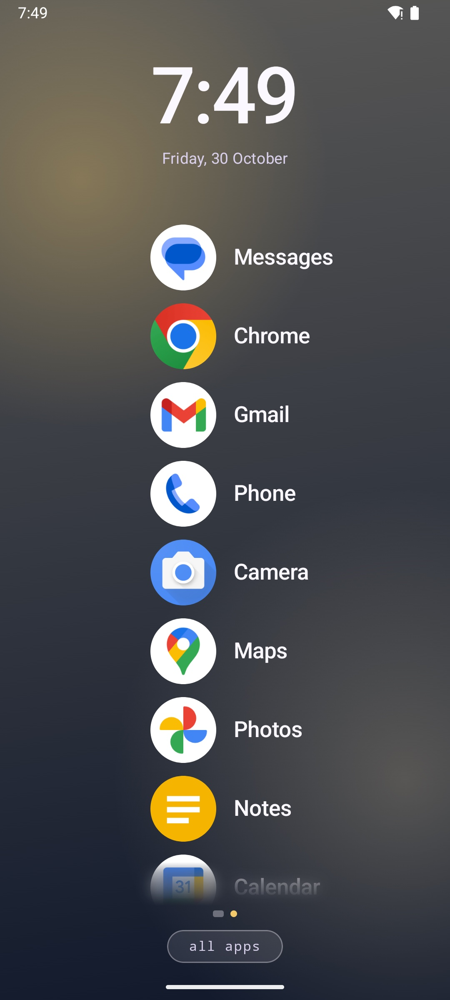
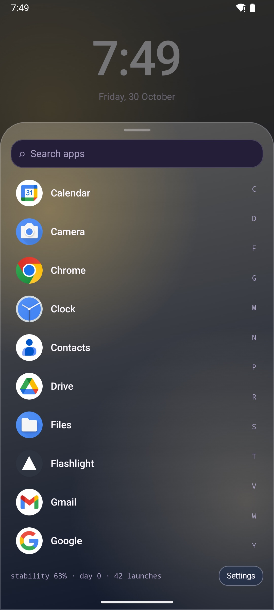
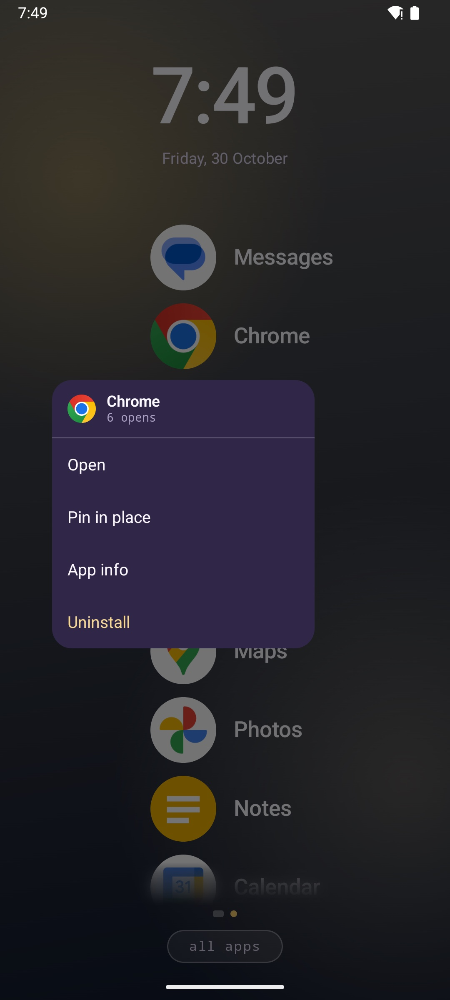
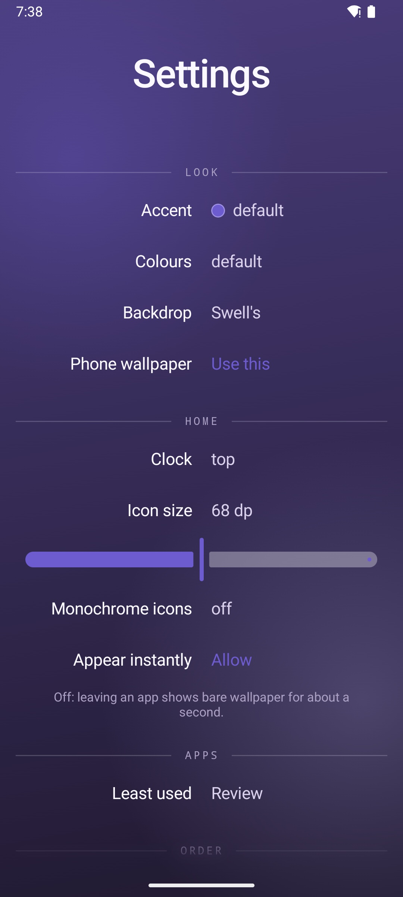
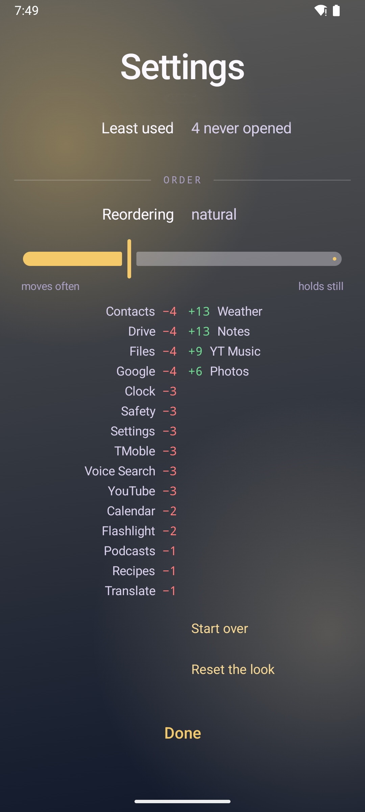
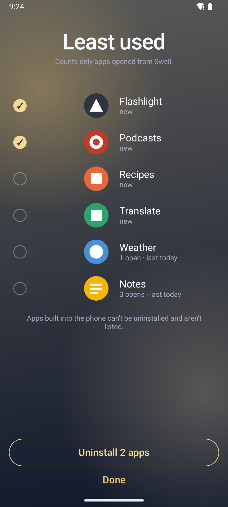

# Swell

An Android home screen that arranges itself.

No folders, nothing to arrange. Home is one list, an app to a line, kept in the order you actually
open things: restless for the first few days, then still enough to learn with your thumb. Pure
Kotlin + Compose. **No INTERNET permission**; your launch history never leaves the phone.

<p>
  
  
  
</p>
<p>
  
  
  
</p>

<sub>Screenshots: Android 15 emulator with sample apps.</sub>

## How it decides

Swell's model is a *seat book*: every app holds a seat, and every launch is a vote for the app
you opened. The rules come from the design prototype the launcher was ported from:

1. **Every launch is a vote.** Votes decay (0.4 % per launch of anything else, 3 % per day), so
   last month matters less than this week, but not enough to yank an app overnight.
2. **An app passes the one above it only by a clear margin.** The margin grows with how high the
   seat is and with how many launches Swell has seen, so close scores don't swap back and forth.
   One launch carries an app as far up as its score allows. An app you have opened is always above
   one you never have.
3. **Every app has a line, in rank order.** The most used app heads the list. A newly installed
   app starts at the bottom. All apps holds the same apps alphabetically, with search.

The model is pure Kotlin (`seats/SeatBook.kt`), imports nothing from Android, and is pinned by
unit tests.

## Install

Download `swell-<version>.apk` from [Releases](https://github.com/keepitlit/swell/releases) and
open it on your phone (Android asks you to allow installs from your browser or file manager the
first time). Release APKs carry the same signature as the Google Play build, so either can update
the other without losing your launch history.

Or build it yourself. You need JDK 17 and the Android SDK (the Gradle wrapper is included):

```
git clone https://github.com/keepitlit/swell
cd swell
./gradlew testDebugUnitTest assembleDebug
adb install -r app/build/outputs/apk/debug/app-debug.apk
```

Then make Swell your home app: press Home and choose Swell, or pick it under **Settings > Apps >
Default apps > Home app** (the path varies a little by phone). From a computer:

```
adb shell cmd package set-home-activity ca.keepitlit.swell/.MainActivity
```

To go back, choose your old home app in the same place, then uninstall Swell like any app.

**First run.** Every app starts in alphabetical order. Open apps from Swell as you normally would
and the list reorders: expect a lot of movement in the first few days and very little after a
week or two. Only launches from Swell count.

## Using it

| To | Do this |
|---|---|
| Open an app | Tap its line. That is the vote. |
| Move through the list | Drag or fling it: the lines stay still and the apps step through them. |
| See app info, uninstall | Long-press a line. |
| Keep an app in a fixed place | Long-press it on home or in all apps, then **Add to dock**. The dock sits against the left edge, centred on the screen, and the app leaves the list until you remove it. |
| Reorder the dock | Long-press a docked app and drag it up or down, or choose **Move up** or **Move down**. |
| Rename an app or change its icon | Long-press it, then **Edit name and icon**. Type a new name, pick an icon from the built-in library (search it by name) and a tile colour, or go back to **Its own icon**. All apps search still finds it by its old name. |
| See all apps | Tap **all apps**, or swipe up anywhere on home. Search, or drag the letters on the right. |
| Open settings | Long-press the clock or **all apps**, or tap **Settings** at the bottom of all apps. |
| Open your clock app | Tap the clock. |
| Use widgets | Swipe right from the list to the widgets page, then **Add a widget**. |

Pinned shortcuts from your browser's **Add to Home screen** join the list like apps; long-press
one and **Remove** deletes the shortcut, not the browser.

### Settings

- **Look:** accent (five swatches or any colour), colours role by role, backdrop (Swell's or your
  phone's wallpaper), and **Phone wallpaper**, which sets Swell's backdrop as a live wallpaper so
  the lock screen and app switcher match.
- **Home:** clock at the top, bottom or off; icon size; monochrome icons; **Appear instantly**
  (see Privacy).
- **Apps > Least used:** every app you can uninstall, least used first, with its opens from
  Swell. Select one or several and tap **Uninstall**; the phone confirms each one, and
  cancelling one stops the rest. Apps built into the phone can't be uninstalled and aren't
  listed.
- **Order:** how readily the list reorders, from *moves often* to *holds still*. Below it, the
  places each app gained (green) or lost (red) over the last few moves.
- **Start over** forgets every launch and returns the list to alphabetical. **Reset the look**
  restores the accent, colours, backdrop, clock and icons.
- **Privacy policy** opens [PRIVACY.md](PRIVACY.md) in your browser.

Work and private profiles are listed alongside personal apps.

## Requirements

Android 8.0 (API 26) or newer. Developed on a OnePlus 12R and a Galaxy S22; other phones should
work, but please open an issue with the model and Android version if the home screen misbehaves.

## Privacy

The full policy is in [PRIVACY.md](PRIVACY.md).

- No `INTERNET` permission. Nothing is sent anywhere.
- `allowBackup="false"`: the seat book (what you open and when) stays on the phone and is not
  included in platform backups.
- Permissions used, each explained in `AndroidManifest.xml`:
  - `ACCESS_HIDDEN_PROFILES`: list Private Space apps.
  - `REQUEST_DELETE_PACKAGES`: Uninstall, from the long-press menu and Least used.
  - `SYSTEM_ALERT_WINDOW` (optional, **Appear instantly**): shows Swell the moment you leave an
    app, instead of a second of bare wallpaper while the system finishes its own animation.

## Building a release

`./gradlew assembleRelease` signs the APK only if a keystore is supplied; otherwise it produces an
**unsigned** APK rather than failing. Set these as environment variables or Gradle properties:

```
SWELL_STORE_FILE      path to the .jks
SWELL_STORE_PASSWORD
SWELL_KEY_ALIAS
SWELL_KEY_PASSWORD
```

Toolchain: AGP 8.9.1, Gradle 8.11.1, Kotlin 2.1.20, JDK 17, compileSdk 36.

## Source layout

- `seats/SeatBook.kt`: the model, pure Kotlin. `seats/LeastUsed.kt`: the least used ordering.
- `theme/Palette.kt`: the palette and the accent arithmetic. `theme/Appearance.kt`: what you
  chose, persisted in SharedPreferences.
- `ui/`: Compose screens: home (`HomeScreen.kt`), all apps (`Drawer.kt`, `AlphabetRail.kt`), the
  long-press menu, settings, least used, the colour picker and the widgets page.
- `data/`, `helper/`: app listing across profiles, launching, the icon cache.
- `wallpaper/`: the live wallpaper service.
- `fastlane/metadata/`: store and F-Droid listing text and screenshots.

## Tests

```
./gradlew testDebugUnitTest
```

Unit tests cover the seat book, the least used ordering and the palette arithmetic. CI runs them
plus `assembleDebug` on every push.

## License

MIT, see `LICENSE`. Copyright (c) 2026 Keep It Lit Software Inc.
